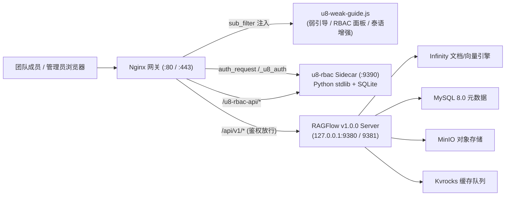

<div align="center">

# U8Flow

**基于 [RAGFlow v1.0.0](https://github.com/infiniflow/ragflow) 深度定制的用友 U8 企业级知识库与团队权限管控平台**

<p align="center">
  <a href="./README.md"></a>
  <a href="./README_en.md"></a>
  <a href="./README_th.md"></a>
  <a href="./README_ja.md"></a>
</p>

<p align="center">
  <a href="https://github.com/Insomniac1008/U8Flow"></a>
  <a href="https://github.com/infiniflow/ragflow"></a>
  <a href="./LICENSE"></a>
  
</p>

</div>

---

## 目录

- [项目简介](#项目简介)
- [核心改进与特色功能](#核心改进与特色功能)
- [系统架构](#系统架构)
- [快速部署](#快速部署)
- [权限管控说明（RBAC）](#权限管控说明rbac)
- [关键定制文件说明](#关键定制文件说明)
- [上游 RAGFlow 核心能力](#上游-ragflow-核心能力)
- [致谢与开源协议](#致谢与开源协议)

---

## 项目简介

**U8Flow**（前端品牌展示为 `InsomniacFlow`）是在开源引擎 [RAGFlow v1.0.0](https://github.com/infiniflow/ragflow) 基础上，面向**用友 U8 财务/业务团队**打造的**零侵入式**企业增强发行版。

项目采用 **Nginx `auth_request` + 轻量级 Python RBAC Sidecar + Nginx `sub_filter` 前端增强层** 架构，在不修改上游 RAGFlow 镜像和前端编译产物的前提下，完整实现了团队级细粒度权限隔离、部门与成员管理、审计日志、U8 场景化弱引导与高频提问模板、以及完整泰语（ภาษาไทย）界面支持，同时保留一键同步上游 RAGFlow 镜像升级的能力。

---

## 核心改进与特色功能

### 1. 轻量级团队 RBAC 权限管控 Sidecar（`u8-rbac`）
- **极简低耗**：仅使用 Python 标准库（`python:3.12-alpine`），运行内存约 20 MB（容器限制 128 MB），策略与审计日志持久化于 SQLite。
- **六大模块三态权限**：在 Nginx 网关层通过 `auth_request /_u8_auth` 拦截全部 `/api/v1` 请求，精细管控 **对话（Chats）**、**搜索（Searches）**、**知识库（Datasets）**、**文件（Files）**、**智能体（Agents）**、**模型配置（Models）** 六大模块，支持 `禁止 (none)` / `只读 (read)` / `可写 (write)` 三种级别。
- **完整团队管理能力**：
  - 支持主负责人（`U8_TEAM_OWNER`）与多管理员（`U8_TEAM_ADMINS`）分级治理。
  - 新登录的 RAGFlow 用户自动纳管至权限表，默认赋予安全只读/对话权限。
  - 支持部门自定义显示名称、按部门或全员批量下发权限、成员增删改查。
  - 支持权限配置 **CSV / JSON 导出**，以及自动留存最近 2000 条的**权限变更审计日志**。
- **网关防绕过加固**：`docker-compose.yml` 将 `9380`（API）与 `9381`（Admin）仅绑定至 `127.0.0.1`，杜绝局域网用户绕过 Nginx 鉴权直接访问后端接口。

### 2. 零侵入前端增强与 U8 弱引导层（`u8-guide`）
- **U8 四步弱引导浮窗**：通过 Nginx `sub_filter` 动态注入，可自由拖拽与收起，并在「设置 → 模型供应商」侧边栏提供快捷显示开关；针对登录、模型配置、知识库构建、对话问答、检索测试、Agent 编排提供上下文操作指引。
- **U8 高频提问模板**：在对话页内置一键填入的用友 U8 实用模板（月末结账报错排查、财务报表同比环比分析、存货核算与总账对账差异、应收/应付单据核销异常）。
- **内置可视化权限管理页**：管理员可直接在导航栏进入「团队权限」页面，完成搜索筛选、单元格点击切换权限、批量配置、部门改名、审计日志查阅与 CSV 导出。
- **成员端权限体验保护**：无权限模块在导航栏自动灰显加锁并拦截路由；只读模块自动展示顶部只读提示条；全禁用账号展示友好无权限提示页。
- **品牌与表单体验优化**：支持自定义品牌名称、内置 U8 团队使用指南弹窗、扩展 GitHub/帮助菜单、移除冗余 Discord 入口，并在系统默认模型配置页补充必填红星标识。

### 3. 多语言与完整泰语（ภาษาไทย）支持
- U8 增强层原生支持 **简体中文 / English / ภาษาไทย** 三语切换，与 RAGFlow 内置语言状态（`localStorage.lng`）联动。
- 内置针对 RAGFlow 原生界面的泰语 DOM 文本翻译字典，并利用 `WeakMap` 缓存原文节点，切换回中文或英文时无需强制刷新页面即可无损还原。

### 4. 轻量高效的默认部署配置
- **默认向量/文档引擎切换为 Infinity**：`docker/.env` 默认启用 `DOC_ENGINE=infinity`，相比 Elasticsearch 大幅降低内存占用，更适合中小规模企业内网服务器部署。
- **精细化内存控制**：为 `ragflow-cpu` 配置 Go 运行时内存上限（`GOMEMLIMIT=1500MiB`、`GOGC=50`），兼顾稳定性与吞吐效率。

---

## 系统架构



---

## 快速部署

### 环境要求
- CPU >= 4 核，内存 >= 8 GB（使用 Infinity 引擎时推荐 16 GB 以上）
- 磁盘可用空间 >= 50 GB
- Docker >= 24.0.0，Docker Compose >= v2.26.1

### 启动步骤

1. **克隆仓库**
   ```bash
   git clone https://github.com/Insomniac1008/U8Flow.git
   cd U8Flow/docker
   ```

2. **检查并按需修改环境变量**
   - 在 `docker/.env` 中可根据实际环境调整密码、端口、`DOC_ENGINE`（默认 `infinity`）及 `RAGFLOW_IMAGE`（国内网络可取消注释华为云或阿里云镜像源）。
   - 在 `docker/docker-compose.yml` 中配置团队主负责人与管理员邮箱：
     ```yaml
     environment:
       - U8_TEAM_OWNER=admin@u8.local
       - U8_TEAM_ADMINS=manager1@u8.local,manager2@u8.local
     ```

3. **启动全部服务**
   ```bash
   docker compose -f docker-compose.yml up -d
   ```

4. **验证服务状态**
   ```bash
   docker compose -f docker-compose.yml ps
   docker logs -f docker-ragflow-cpu-1
   ```
   待服务启动完成后，浏览器访问 `http://<服务器IP>` 即可进入 U8Flow。

---

## 权限管控说明（RBAC）

| 权限级别 | 标识 | 允许行为 |
| :--- | :--- | :--- |
| **可写** | `write` | 允许查看、检索、新建、上传、编辑与删除 |
| **只读** | `read` | 仅允许浏览与检索（`GET`/`HEAD`/`OPTIONS` 及检索接口），拦截所有写入操作 |
| **禁止** | `none` | 拦截该模块的全部 API 请求，前端导航栏灰显加锁并阻止跳转 |

**常用 RBAC Sidecar 接口（经由 `/u8-rbac-api/` 代理）：**
- `GET /u8-rbac-api/me`：获取当前登录用户权限与管理员身份
- `GET /u8-rbac-api/policies`：获取全部成员权限与部门映射（仅管理员）
- `POST / PUT / DELETE /u8-rbac-api/policies/user`：新增、修改或移除成员权限
- `PUT /u8-rbac-api/policies/dept`：按部门或全员批量调整模块权限
- `GET /u8-rbac-api/policies/export?format=csv|json`：导出权限配置
- `GET /u8-rbac-api/audit-logs?limit=100`：查询权限变更审计日志

---

## 关键定制文件说明

| 文件路径 | 说明 |
| :--- | :--- |
| [`docker/u8-rbac/server.py`](./docker/u8-rbac/server.py) | 轻量级 RBAC 鉴权与管理 Sidecar 服务（SQLite 持久化、审计日志、CSV/JSON 导出） |
| [`docker/u8-guide/u8-weak-guide.js`](./docker/u8-guide/u8-weak-guide.js) | 零侵入前端增强脚本（U8 弱引导、提问模板、权限管理面板、路由拦截、泰语翻译） |
| [`docker/nginx/ragflow.conf`](./docker/nginx/ragflow.conf) | Nginx 网关配置（`auth_request` 鉴权拦截、`u8-rbac-api` 反向代理、`sub_filter` 注入） |
| [`docker/docker-compose.yml`](./docker/docker-compose.yml) | 服务编排配置（集成 `u8-rbac` 容器、本地回环端口加固、Go 内存优化） |
| [`docker/.env`](./docker/.env) | 默认环境配置（默认采用 `Infinity` 文档引擎、支持注册开关与镜像源配置） |

---

## 上游 RAGFlow 核心能力

U8Flow 完整保留了 **RAGFlow v1.0.0** 的所有核心能力：
- **深度文档理解（DeepDoc）**：支持复杂版式 PDF、Word、Excel、PPT、图片、扫描件的高精度解析与 OCR。
- **模板化可控切片**：支持 General、Manual、Table、Paper、Book、Laws 等多种业务切片模板，回答可溯源至原文位置。
- **知识编译（Knowledge Compilation）**：支持文档与知识库级编译生成 Wiki、Graph、Tree、PageIndex、Mind Map、Timeline 与 Skills。
- **Agentic RAG 与工作流编排**：支持多步检索推理与可视化 Agent 编排，兼容主流商业及本地 LLM 与 MCP 协议。

更多上游文档请参阅 [RAGFlow 官方文档](https://ragflow.io/docs/dev/)。

---

## 致谢与开源协议

- 本项目基于 [InfiniFlow / RAGFlow](https://github.com/infiniflow/ragflow) 构建，谨向 RAGFlow 开源社区致谢。
- 定制与维护：[Insomniac1008 (IcyFrog)](https://github.com/Insomniac1008)。
- 本项目遵循 [Apache-2.0 License](./LICENSE) 开源协议。
