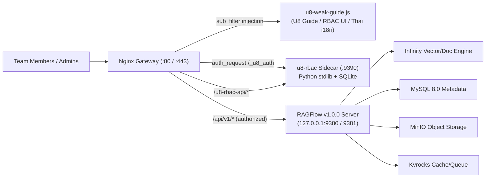

<div align="center">

# U8Flow

**Enterprise Knowledge Base & Team RBAC Platform Built on [RAGFlow v1.0.0](https://github.com/infiniflow/ragflow) for Yongyou U8 Teams**

<p align="center">
  <a href="./README.md"></a>
  <a href="./README_en.md"></a>
  <a href="./README_th.md"></a>
  <a href="./README_ja.md"></a>
</p>

<p align="center">
  <a href="https://github.com/Insomniac1008/U8Flow"></a>
  <a href="https://github.com/infiniflow/ragflow"></a>
  <a href="./LICENSE"></a>
  
</p>

</div>

---

## Table of Contents

- [Overview](#overview)
- [Key Enhancements](#key-enhancements)
- [Architecture](#architecture)
- [Quick Start](#quick-start)
- [RBAC Permission Model](#rbac-permission-model)
- [Customized Files](#customized-files)
- [Upstream RAGFlow Capabilities](#upstream-ragflow-capabilities)
- [Acknowledgements & License](#acknowledgements--license)

---

## Overview

**U8Flow** (UI brand: `InsomniacFlow`) is a **non-invasive** enterprise distribution built on [RAGFlow v1.0.0](https://github.com/infiniflow/ragflow), tailored for **Yongyou U8 (用友 U8)** finance and operations teams.

By combining **Nginx `auth_request` + a lightweight Python RBAC Sidecar + Nginx `sub_filter` UI overlay**, U8Flow delivers fine-grained team RBAC, department & member governance, audit logging, U8 contextual onboarding & prompt templates, and full Thai (`ภาษาไทย`) UI localization — all without modifying upstream RAGFlow binaries or compiled frontend bundles, keeping future upstream image upgrades seamless.

---

## Key Enhancements

### 1. Lightweight Team RBAC Sidecar (`u8-rbac`)
- **Minimal Footprint**: Built purely with the Python 3.12 standard library (`python:3.12-alpine`, ~20 MB RAM, 128 MB container cap) with SQLite persistence.
- **6-Module Tri-State Access Control**: Intercepts all `/api/v1` requests at the Nginx gateway via `auth_request /_u8_auth`, enforcing `Blocked (none)`, `Read-only (read)`, and `Read/Write (write)` policies across **Chats**, **Searches**, **Datasets**, **Files**, **Agents**, and **Models**.
- **Team & Audit Governance**:
  - Primary owner (`U8_TEAM_OWNER`) and delegated team admins (`U8_TEAM_ADMINS`).
  - Automatic enrollment of newly signed-in RAGFlow users with safe default permissions.
  - Custom department display names, batch updates by department or all members, and member CRUD.
  - **CSV / JSON policy export** and automatic retention of the latest 2,000 **permission audit log** entries.
- **Gateway Hardening**: Binds direct API (`9380`) and Admin (`9381`) ports to `127.0.0.1` in `docker-compose.yml` so LAN users cannot bypass Nginx RBAC enforcement.

### 2. Non-Invasive Frontend Overlay & U8 Guide (`u8-guide`)
- **4-Step Floating U8 Guide**: Injected via Nginx `sub_filter`; draggable, collapsible, and toggleable from `Settings → Model Providers`. Provides route-aware guidance across Login, Model Setup, Datasets, Chat Q&A, Retrieval Testing, and Agent Workflows.
- **U8 Quick Prompt Templates**: One-click prompt templates on the Chat page for common Yongyou U8 scenarios (Month-end Closing Errors, Financial Report YoY/MoM Analysis, Inventory-to-GL Reconciliation, and AR/AP Write-off Troubleshooting).
- **Integrated Team RBAC Console**: Admins can manage permissions directly from the navigation bar with search/filtering, click-to-cycle permission cells, batch operations, department renaming, audit log viewer, and CSV export.
- **Member UX Safeguards**: Locked modules are dimmed with lock badges and route-guarded; read-only modules display a clear read-only banner; fully restricted accounts see a friendly no-access page.
- **UI & Branding Polish**: Custom brand display (`InsomniacFlow`), built-in U8 Team User Guide modal, extended GitHub/Help popovers, hidden Discord link, and required-field indicators (`*`) for system default models.

### 3. Multi-Language & Full Thai (`ภาษาไทย`) Support
- Native **Simplified Chinese / English / Thai** switching synchronized with RAGFlow's `localStorage.lng`.
- Includes a built-in Thai DOM dictionary for RAGFlow's native UI with a `WeakMap` original-text cache for clean, reload-free switching back to other languages.

### 4. Lightweight Production-Ready Defaults
- **Infinity as Default Doc Engine**: `docker/.env` defaults to `DOC_ENGINE=infinity`, significantly reducing RAM requirements compared to Elasticsearch.
- **Go Memory Tuning**: Configures `GOMEMLIMIT=1500MiB` and `GOGC=50` on `ragflow-cpu` for stable operation on mid-sized intranet servers.

---

## Architecture



---

## Quick Start

### Prerequisites
- CPU >= 4 cores, RAM >= 8 GB (16 GB+ recommended with Infinity)
- Disk >= 50 GB
- Docker >= 24.0.0 & Docker Compose >= v2.26.1

### Deployment Steps

1. **Clone the repository**
   ```bash
   git clone https://github.com/Insomniac1008/U8Flow.git
   cd U8Flow/docker
   ```

2. **Configure environment variables**
   - Review `docker/.env` to update default passwords, ports, `DOC_ENGINE` (default `infinity`), and `RAGFLOW_IMAGE` mirrors if needed.
   - Set your team owner and optional admins in `docker/docker-compose.yml`:
     ```yaml
     environment:
       - U8_TEAM_OWNER=admin@u8.local
       - U8_TEAM_ADMINS=manager1@u8.local,manager2@u8.local
     ```

3. **Start the stack**
   ```bash
   docker compose -f docker-compose.yml up -d
   ```

4. **Verify status**
   ```bash
   docker compose -f docker-compose.yml ps
   docker logs -f docker-ragflow-cpu-1
   ```
   Open `http://<SERVER_IP>` in your browser once initialization completes.

---

## RBAC Permission Model

| Level | Value | Allowed Operations |
| :--- | :--- | :--- |
| **Read/Write** | `write` | Full view, search, create, upload, edit, and delete access |
| **Read-only** | `read` | View and search only (`GET`/`HEAD`/`OPTIONS` and retrieval endpoints); mutations blocked |
| **Blocked** | `none` | All API calls rejected (`403`); navigation item dimmed/locked and route blocked |

**RBAC Sidecar API Endpoints (proxied under `/u8-rbac-api/`):**
- `GET /u8-rbac-api/me` — Current user profile, admin flags, and effective permissions
- `GET /u8-rbac-api/policies` — List all member policies and department display names (admin only)
- `POST / PUT / DELETE /u8-rbac-api/policies/user` — Add, update, or remove a member policy
- `PUT /u8-rbac-api/policies/dept` — Batch-update policies for a department or all non-admin members
- `GET /u8-rbac-api/policies/export?format=csv|json` — Export policies as CSV or JSON
- `GET /u8-rbac-api/audit-logs?limit=100` — View permission change audit logs

---

## Customized Files

| File Path | Description |
| :--- | :--- |
| [`docker/u8-rbac/server.py`](./docker/u8-rbac/server.py) | Lightweight RBAC sidecar (SQLite persistence, audit logs, CSV/JSON export) |
| [`docker/u8-guide/u8-weak-guide.js`](./docker/u8-guide/u8-weak-guide.js) | Non-invasive frontend overlay (U8 guide, quick prompts, RBAC console, route guards, Thai i18n) |
| [`docker/nginx/ragflow.conf`](./docker/nginx/ragflow.conf) | Nginx gateway (`auth_request`, `/u8-rbac-api/` proxy, `sub_filter` script injection) |
| [`docker/docker-compose.yml`](./docker/docker-compose.yml) | Compose orchestration (`u8-rbac` service, localhost-only API/Admin binding, Go memory limits) |
| [`docker/.env`](./docker/.env) | Default environment config (`DOC_ENGINE=infinity`, registration & mirror options) |

---

## Upstream RAGFlow Capabilities

U8Flow preserves 100% of **RAGFlow v1.0.0** core capabilities:
- **DeepDoc Document Understanding**: High-accuracy layout analysis, table extraction, and OCR for PDFs, Word, Excel, PPT, and scanned documents.
- **Template-Based Chunking**: Controllable, grounded chunking templates (General, Manual, Table, Paper, Book, Laws) with inline citations.
- **Knowledge Compilation**: Compile documents and datasets into Wiki, Graph, Tree, PageIndex, Mind Map, Timeline, and Skills.
- **Agentic RAG & Workflows**: Multi-step agentic retrieval, visual workflow orchestration, multi-LLM support, and native MCP support.

See the [official RAGFlow documentation](https://ragflow.io/docs/dev/) for full details.

---

## Acknowledgements & License

- Built on [InfiniFlow / RAGFlow](https://github.com/infiniflow/ragflow) — huge thanks to the RAGFlow open-source community.
- Maintained by [Insomniac1008 (IcyFrog)](https://github.com/Insomniac1008).
- Licensed under the [Apache-2.0 License](./LICENSE).
