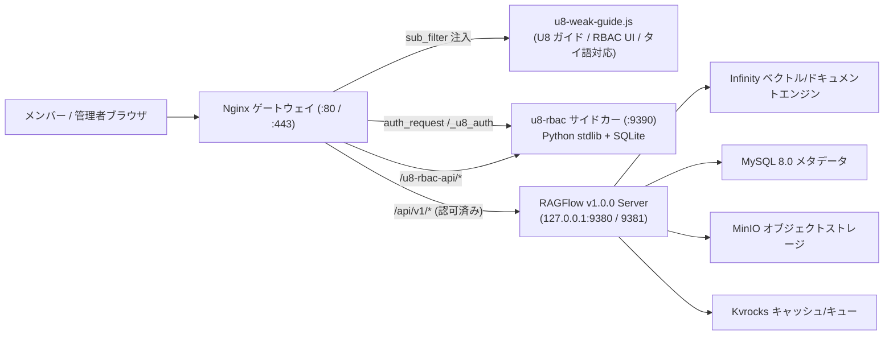

<div align="center">

# U8Flow

**[RAGFlow v1.0.0](https://github.com/infiniflow/ragflow) をベースに構築された、用友 U8 チーム向けエンタープライズ知識ベース＆チーム権限管理（RBAC）プラットフォーム**

<p align="center">
  <a href="./README.md"></a>
  <a href="./README_en.md"></a>
  <a href="./README_th.md"></a>
  <a href="./README_ja.md"></a>
</p>

<p align="center">
  <a href="https://github.com/Insomniac1008/U8Flow"></a>
  <a href="https://github.com/infiniflow/ragflow"></a>
  <a href="./LICENSE"></a>
  
</p>

</div>

---

## 目次

- [概要](#概要)
- [主な拡張機能](#主な拡張機能)
- [システムアーキテクチャ](#システムアーキテクチャ)
- [クイックスタート](#クイックスタート)
- [RBAC 権限モデル](#rbac-権限モデル)
- [主なカスタマイズファイル](#主なカスタマイズファイル)
- [アップストリーム RAGFlow のコア機能](#アップストリーム-ragflow-のコア機能)
- [謝辞・ライセンス](#謝辞ライセンス)

---

## 概要

**U8Flow**（UI ブランド名：`InsomniacFlow`）は、オープンソース RAG エンジン [RAGFlow v1.0.0](https://github.com/infiniflow/ragflow) を基盤とし、**用友 U8（Yongyou U8）財務・業務チーム**向けに最適化された**非侵襲型**エンタープライズディストリビューションです。

**Nginx `auth_request` + 軽量 Python RBAC サイドカー + Nginx `sub_filter` フロントエンド拡張**を採用することで、アップストリームの RAGFlow バイナリやフロントエンドビルド成果物を一切変更することなく、きめ細かいチーム RBAC、部署・メンバー管理、監査ログ、U8 向け操作ガイド・定型プロンプト、およびタイ語（ภาษาไทย）UI 対応を実現しています。これにより、将来の RAGFlow イメージアップデートもスムーズに行えます。

---

## 主な拡張機能

### 1. 軽量チーム RBAC サイドカー（`u8-rbac`）
- **超軽量設計**：Python 3.12 標準ライブラリのみ（`python:3.12-alpine`）で動作し、消費メモリは約 20 MB（コンテナ上限 128 MB）。ポリシーと監査ログは SQLite に永続化されます。
- **6 モジュール × 3 段階の権限制御**：Nginx ゲートウェイで `auth_request /_u8_auth` により全 `/api/v1` リクエストを検証し、**チャット（Chats）**、**検索（Searches）**、**知識ベース（Datasets）**、**ファイル（Files）**、**エージェント（Agents）**、**モデル設定（Models）** の各モジュールに対して `禁止 (none)` / `閲覧のみ (read)` / `読み書き可 (write)` を制御します。
- **充実したチーム管理機能**：
  - オーナー（`U8_TEAM_OWNER`）および追加管理者（`U8_TEAM_ADMINS`）による階層管理。
  - 新規ログインした RAGFlow ユーザーを権限テーブルへ自動登録（安全なデフォルト権限を付与）。
  - 部署表示名のカスタマイズ、部署別・全体の一括権限変更、メンバーの追加・編集・削除。
  - 権限設定の **CSV / JSON エクスポート** および直近 2,000 件の**権限変更監査ログ**を自動記録。
- **ゲートウェイ保護強化**：`docker-compose.yml` で API（`9380`）および Admin（`9381`）ポートを `127.0.0.1` のみにバインドし、LAN 内から Nginx RBAC をバイパスする直接アクセスを防止します。

### 2. 非侵襲フロントエンド拡張＆U8 ガイド（`u8-guide`）
- **4 ステップ U8 フローティングガイド**：Nginx `sub_filter` 経由で注入され、ドラッグ移動・折りたたみに対応。「設定 → モデルプロバイダー」サイドバーから表示切替が可能で、各画面に応じた操作ヒントを提示します。
- **U8 業務向けクイックプロンプト**：チャット画面にワンクリック入力できる用友 U8 テンプレートを搭載（月末締めエラー調査、財務諸表 YoY/MoM 分析、在庫勘定と総勘定元帳の照合差異、売掛/買掛消込エラー）。
- **統合チーム権限管理画面**：管理者はナビゲーションバーから「チーム権限」画面へ直接アクセスでき、検索・フィルタ、セルクリックによる権限切替、一括適用、部署名変更、監査ログ閲覧、CSV エクスポートを実行できます。
- **メンバー向け UX 保護**：禁止モジュールはナビゲーション上でロック表示・遷移ブロックされ、閲覧専用モジュールには専用バナーを表示。全モジュール禁止アカウントには案内画面を表示します。
- **UI・ブランディング最適化**：カスタムブランド表示（`InsomniacFlow`）、内蔵 U8 チーム利用ガイドモーダル、GitHub / ヘルプメニュー拡張、Discord リンク非表示、必須システムモデルへの `*` マーク表示。

### 3. マルチ言語＆タイ語（ภาษาไทย）UI フルサポート
- **简体中文 / English / ภาษาไทย** の切替に対応し、RAGFlow の言語設定（`localStorage.lng`）と連動します。
- RAGFlow 標準 UI 向けのタイ語 DOM 翻訳辞書と `WeakMap` 原文キャッシュを内蔵し、他言語へ戻す際もページリロードなしで復元可能です。

### 4. 軽量・本番向けのデフォルト構成
- **Infinity をデフォルトドキュメントエンジンに採用**：`docker/.env` で `DOC_ENGINE=infinity` を既定とし、Elasticsearch に比べ大幅な省メモリ化を実現。
- **Go メモリチューニング**：`ragflow-cpu` に `GOMEMLIMIT=1500MiB`・`GOGC=50` を設定し、社内サーバーでの安定稼働を確保。

---

## システムアーキテクチャ



---

## クイックスタート

### 動作要件
- CPU >= 4 コア、メモリ >= 8 GB（Infinity 使用時は 16 GB 以上推奨）
- ディスク空き容量 >= 50 GB
- Docker >= 24.0.0、Docker Compose >= v2.26.1

### デプロイ手順

1. **リポジトリをクローン**
   ```bash
   git clone https://github.com/Insomniac1008/U8Flow.git
   cd U8Flow/docker
   ```

2. **環境変数を設定**
   - `docker/.env` でパスワード、ポート、`DOC_ENGINE`（デフォルト `infinity`）、必要に応じたイメージミラーを確認・更新します。
   - `docker/docker-compose.yml` でチームオーナーと管理者メールアドレスを設定します：
     ```yaml
     environment:
       - U8_TEAM_OWNER=admin@u8.local
       - U8_TEAM_ADMINS=manager1@u8.local,manager2@u8.local
     ```

3. **サービスを起動**
   ```bash
   docker compose -f docker-compose.yml up -d
   ```

4. **稼働状態を確認**
   ```bash
   docker compose -f docker-compose.yml ps
   docker logs -f docker-ragflow-cpu-1
   ```
   起動完了後、ブラウザで `http://<サーバーIP>` にアクセスしてください。

---

## RBAC 権限モデル

| 権限レベル | 値 | 許可される操作 |
| :--- | :--- | :--- |
| **読み書き可** | `write` | 閲覧・検索・作成・アップロード・編集・削除すべて可能 |
| **閲覧のみ** | `read` | 閲覧・検索のみ許可（`GET`/`HEAD`/`OPTIONS` および検索 API）。書き込み操作はブロック |
| **禁止** | `none` | 全 API リクエストを拒否（`403`）。ナビゲーションをロックしルート遷移を遮断 |

**主な RBAC サイドカー API（`/u8-rbac-api/` 経由）：**
- `GET /u8-rbac-api/me` — 現在のユーザー情報・管理者フラグ・有効権限を取得
- `GET /u8-rbac-api/policies` — 全メンバーの権限一覧と部署名マップを取得（管理者専用）
- `POST / PUT / DELETE /u8-rbac-api/policies/user` — メンバー権限の追加・更新・削除
- `PUT /u8-rbac-api/policies/dept` — 部署単位または全メンバーへの一括権限更新
- `GET /u8-rbac-api/policies/export?format=csv|json` — 権限設定の CSV / JSON エクスポート
- `GET /u8-rbac-api/audit-logs?limit=100` — 権限変更監査ログの取得

---

## 主なカスタマイズファイル

| ファイルパス | 説明 |
| :--- | :--- |
| [`docker/u8-rbac/server.py`](./docker/u8-rbac/server.py) | 軽量 RBAC サイドカー（SQLite 永続化、監査ログ、CSV/JSON エクスポート） |
| [`docker/u8-guide/u8-weak-guide.js`](./docker/u8-guide/u8-weak-guide.js) | 非侵襲フロントエンド拡張（U8 ガイド、定型プロンプト、権限管理 UI、タイ語翻訳） |
| [`docker/nginx/ragflow.conf`](./docker/nginx/ragflow.conf) | Nginx 設定（`auth_request` 認可、`/u8-rbac-api/` プロキシ、`sub_filter` 注入） |
| [`docker/docker-compose.yml`](./docker/docker-compose.yml) | Compose 定義（`u8-rbac` 追加、localhost ポート制限、Go メモリ最適化） |
| [`docker/.env`](./docker/.env) | デフォルト環境変数（`DOC_ENGINE=infinity`、登録設定、ミラー設定） |

---

## アップストリーム RAGFlow のコア機能

U8Flow は **RAGFlow v1.0.0** のすべてのコア機能をそのまま利用できます：
- **DeepDoc 文書理解**：複雑なレイアウトの PDF、Word、Excel、PPT、スキャン画像に対する高精度な構造解析と OCR。
- **テンプレートベースのチャンク分割**：General / Manual / Table / Paper / Book / Laws など制御可能なチャンク分割と出典ハイライト。
- **知識コンパイル（Knowledge Compilation）**：文書・知識ベースから Wiki、Graph、Tree、PageIndex、Mind Map、Timeline、Skills を自動生成。
- **Agentic RAG ＆ワークフロー**：多段階検索推論、ビジュアル Agent ワークフロー、主要 LLM および MCP プロトコル対応。

詳細は [RAGFlow 公式ドキュメント](https://ragflow.io/docs/dev/) をご参照ください。

---

## 謝辞・ライセンス

- 本プロジェクトは [InfiniFlow / RAGFlow](https://github.com/infiniflow/ragflow) をベースに構築されています。RAGFlow オープンソースコミュニティに感謝いたします。
- 開発・メンテナンス：[Insomniac1008 (IcyFrog)](https://github.com/Insomniac1008)
- ライセンス：[Apache-2.0 License](./LICENSE)
