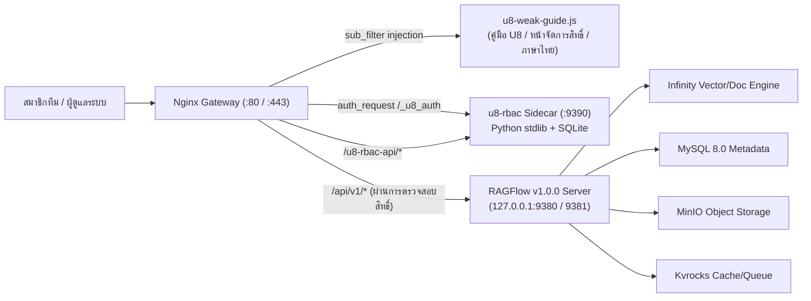

<div align="center">

# U8Flow

**แพลตฟอร์มฐานความรู้องค์กรและระบบจัดการสิทธิ์ทีม (RBAC) สำหรับทีม Yongyou U8 บนพื้นฐาน [RAGFlow v1.0.0](https://github.com/infiniflow/ragflow)**

<p align="center">
  <a href="./README.md"></a>
  <a href="./README_en.md"></a>
  <a href="./README_th.md"></a>
  <a href="./README_ja.md"></a>
</p>

<p align="center">
  <a href="https://github.com/Insomniac1008/U8Flow"></a>
  <a href="https://github.com/infiniflow/ragflow"></a>
  <a href="./LICENSE"></a>
  
</p>

</div>

---

## สารบัญ

- [ภาพรวมโครงการ](#ภาพรวมโครงการ)
- [ฟีเจอร์ที่ปรับปรุงเพิ่มเติม](#ฟีเจอร์ที่ปรับปรุงเพิ่มเติม)
- [สถาปัตยกรรมระบบ](#สถาปัตยกรรมระบบ)
- [การติดตั้งและเริ่มต้นใช้งาน](#การติดตั้งและเริ่มต้นใช้งาน)
- [ระบบควบคุมสิทธิ์ทีม (RBAC)](#ระบบควบคุมสิทธิ์ทีม-rbac)
- [ไฟล์สำคัญที่ปรับแต่ง](#ไฟล์สำคัญที่ปรับแต่ง)
- [ความสามารถหลักจาก RAGFlow ต้นฉบับ](#ความสามารถหลักจาก-ragflow-ต้นฉบับ)
- [กิตติกรรมประกาศและสัญญาอนุญาต](#กิตติกรรมประกาศและสัญญาอนุญาต)

---

## ภาพรวมโครงการ

**U8Flow** (ชื่อแสดงผลบนหน้าเว็บ `InsomniacFlow`) คือเวอร์ชันปรับแต่งระดับองค์กรที่พัฒนาต่อยอดจาก [RAGFlow v1.0.0](https://github.com/infiniflow/ragflow) โดยออกแบบมาเฉพาะสำหรับ**ทีมบัญชีและการปฏิบัติงาน Yongyou U8 (用友 U8)**

โครงการใช้สถาปัตยกรรมแบบ**ไม่แก้ไขโค้ดต้นฉบับ (Non-Invasive)** ผ่าน **Nginx `auth_request` + Python RBAC Sidecar น้ำหนักเบา + Nginx `sub_filter` Frontend Overlay** ทำให้สามารถเพิ่มระบบควบคุมสิทธิ์รายโมดูล จัดการสมาชิกและแผนก บันทึกประวัติการแก้ไข คู่มือแนะนำการใช้งาน U8 เทมเพลตคำถามด่วน และหน้าจอภาษาไทยได้อย่างสมบูรณ์ โดยยังคงอัปเกรดอิมเมจ RAGFlow ต้นทางได้ง่าย

---

## ฟีเจอร์ที่ปรับปรุงเพิ่มเติม

### 1. ระบบควบคุมสิทธิ์ทีมน้ำหนักเบา (`u8-rbac` Sidecar)
- **ประหยัดทรัพยากร**: พัฒนาด้วย Python 3.12 Standard Library ล้วน (`python:3.12-alpine`) ใช้หน่วยความจำเพียง ~20 MB (จำกัดสูงสุด 128 MB) และจัดเก็บข้อมูลลง SQLite
- **ควบคุมสิทธิ์ 3 ระดับใน 6 โมดูลหลัก**: ตรวจสอบทุกคำขอ `/api/v1` ที่เกตเวย์ Nginx ผ่าน `auth_request /_u8_auth` ครอบคลุม **แชท (Chats)**, **ค้นหา (Searches)**, **ฐานความรู้ (Datasets)**, **ไฟล์ (Files)**, **เอเจนต์ (Agents)** และ **โมเดล (Models)** โดยกำหนดสิทธิ์ได้เป็น `ห้ามเข้า (none)` / `อ่านเท่านั้น (read)` / `แก้ไขได้ (write)`
- **การบริหารจัดการทีมและบันทึกตรวจสอบ**:
  - รองรับหัวหน้าทีมหลัก (`U8_TEAM_OWNER`) และผู้ดูแลเพิ่มเติม (`U8_TEAM_ADMINS`)
  - ลงทะเบียนผู้ใช้ใหม่ที่เข้าสู่ระบบ RAGFlow โดยอัตโนมัติพร้อมสิทธิ์เริ่มต้นที่ปลอดภัย
  - ตั้งชื่อแสดงผลของแต่ละแผนก อัปเดตสิทธิ์แบบกลุ่มตามแผนกหรือทั้งทีม และเพิ่ม/แก้ไข/ลบสมาชิกได้ทันที
  - รองรับการ**ส่งออกสิทธิ์เป็น CSV / JSON** และเก็บบันทึก**ประวัติการเปลี่ยนแปลงสิทธิ์ (Audit Logs)** ล่าสุด 2,000 รายการ
- **เสริมความปลอดภัยระดับเครือข่าย**: `docker-compose.yml` ผูกพอร์ต API (`9380`) และ Admin (`9381`) ไว้เฉพาะ `127.0.0.1` เพื่อป้องกันการเข้าถึงตรงโดยข้ามผ่าน Nginx RBAC

### 2. ส่วนเสริมหน้าเว็บและคู่มือแนะนำ U8 (`u8-guide`)
- **หน้าต่างคู่มือแนะนำ U8 แบบ 4 ขั้นตอน**: แทรกผ่าน Nginx `sub_filter` สามารถลากย้าย ย่อเก็บ และเปิด/ปิดได้จากเมนู `ตั้งค่า → ผู้ให้บริการโมเดล` พร้อมคำแนะนำตามหน้าปัจจุบัน (เข้าสู่ระบบ, ตั้งค่าโมเดล, ฐานความรู้, แชทถาม-ตอบ, ทดสอบค้นหา, เวิร์กโฟลว์ Agent)
- **เทมเพลตคำถามด่วนสำหรับ U8**: คลิกเดียวเพื่อเติมคำถามที่พบบ่อยในหน้าแชท เช่น การปิดบัญชีสิ้นเดือน วิเคราะห์งบการเงิน YoY/MoM กระทบยอดสินค้าคงคลังกับ GL และตรวจสอบการตัดยอดลูกหนี้/เจ้าหนี้
- **หน้าจัดการสิทธิ์ทีมในตัว**: ผู้ดูแลสามารถเปิดหน้า「สิทธิ์ทีม」จากแถบนำทาง เพื่อค้นหาสมาชิก คลิกเปลี่ยนสิทธิ์ในตาราง ปรับสิทธิ์แบบกลุ่ม เปลี่ยนชื่อแผนก ดูบันทึกประวัติ และส่งออก CSV
- **ประสบการณ์ใช้งานที่ปลอดภัยสำหรับสมาชิก**: โมดูลที่ถูกปิดจะแสดงไอคอนล็อกและป้องกันการเข้าถึง โมดูลอ่านอย่างเดียวจะแสดงแถบแจ้งเตือนด้านบน และบัญชีที่ไม่มีสิทธิ์ใดเลยจะแสดงหน้าคำแนะนำติดต่อหัวหน้าทีม
- **ปรับปรุงรายละเอียด UI**: รองรับชื่อแบรนด์ `InsomniacFlow` หน้าต่างคู่มือทีม U8 เมนู GitHub/เอกสารช่วยเหลือ ซ่อนลิงก์ Discord และแสดงเครื่องหมายดอกจัน (`*`) สำหรับโมเดลระบบที่จำเป็นต้องตั้งค่า

### 3. รองรับหลายภาษาและภาษาไทย (`ภาษาไทย`) เต็มรูปแบบ
- สลับภาษา **简体中文 / English / ภาษาไทย** ได้ทันทีโดยเชื่อมโยงกับสถานะภาษาของ RAGFlow (`localStorage.lng`)
- มีพจนานุกรมแปลข้อความ DOM สำหรับหน้าจอพื้นฐานของ RAGFlow พร้อมแคชข้อความเดิมด้วย `WeakMap` ทำให้สลับกลับภาษาอื่นได้อย่างราบรื่นโดยไม่ต้องรีโหลดหน้า

### 4. ค่าเริ่มต้นพร้อมใช้งานและประหยัดหน่วยความจำ
- **ใช้ Infinity เป็นเอนจินเอกสารเริ่มต้น**: `docker/.env` ตั้งค่า `DOC_ENGINE=infinity` ช่วยลดการใช้ RAM ลงอย่างมากเมื่อเทียบกับ Elasticsearch
- **ปรับจูนหน่วยความจำ Go**: ตั้งค่า `GOMEMLIMIT=1500MiB` และ `GOGC=50` สำหรับ `ragflow-cpu` เพื่อความเสถียรบนเซิร์ฟเวอร์ภายในองค์กร

---

## สถาปัตยกรรมระบบ



---

## การติดตั้งและเริ่มต้นใช้งาน

### ความต้องการของระบบ
- CPU >= 4 คอร์, RAM >= 8 GB (แนะนำ 16 GB ขึ้นไปเมื่อใช้ Infinity)
- พื้นที่ดิสก์ว่าง >= 50 GB
- Docker >= 24.0.0 และ Docker Compose >= v2.26.1

### ขั้นตอนการติดตั้ง

1. **โคลนคลังโค้ด**
   ```bash
   git clone https://github.com/Insomniac1008/U8Flow.git
   cd U8Flow/docker
   ```

2. **ตั้งค่าตัวแปรสภาพแวดล้อม**
   - ตรวจสอบและเปลี่ยนรหัสผ่านเริ่มต้น พอร์ต หรือ `DOC_ENGINE` ใน `docker/.env`
   - กำหนดอีเมลหัวหน้าทีมและผู้ดูแลใน `docker/docker-compose.yml`:
     ```yaml
     environment:
       - U8_TEAM_OWNER=admin@u8.local
       - U8_TEAM_ADMINS=manager1@u8.local,manager2@u8.local
     ```

3. **เริ่มต้นบริการทั้งหมด**
   ```bash
   docker compose -f docker-compose.yml up -d
   ```

4. **ตรวจสอบสถานะการทำงาน**
   ```bash
   docker compose -f docker-compose.yml ps
   docker logs -f docker-ragflow-cpu-1
   ```
   เมื่อระบบเริ่มต้นเรียบร้อยแล้ว เปิดเบราว์เซอร์ไปที่ `http://<IP-เซิร์ฟเวอร์>`

---

## ระบบควบคุมสิทธิ์ทีม (RBAC)

| ระดับสิทธิ์ | ค่าในระบบ | สิทธิ์ที่อนุญาต |
| :--- | :--- | :--- |
| **แก้ไขได้** | `write` | ดู ค้นหา สร้าง อัปโหลด แก้ไข และลบได้ทั้งหมด |
| **อ่านเท่านั้น** | `read` | ดูและค้นหาได้เท่านั้น (`GET`/`HEAD`/`OPTIONS` และ API ค้นหา) บล็อกการแก้ไขทั้งหมด |
| **ห้ามเข้า** | `none` | บล็อกคำขอ API ทั้งหมด (`403`) ล็อกเมนูและป้องกันการเข้าถึงหน้า |

**API หลักของ RBAC Sidecar (ผ่านพร็อกซี `/u8-rbac-api/`):**
- `GET /u8-rbac-api/me` — ตรวจสอบข้อมูลผู้ใช้และสิทธิ์ปัจจุบัน
- `GET /u8-rbac-api/policies` — ดูรายการสิทธิ์สมาชิกทั้งหมดและชื่อแผนก (เฉพาะผู้ดูแล)
- `POST / PUT / DELETE /u8-rbac-api/policies/user` — เพิ่ม แก้ไข หรือลบสิทธิ์สมาชิก
- `PUT /u8-rbac-api/policies/dept` — ตั้งค่าสิทธิ์แบบกลุ่มตามแผนกหรือทั้งทีม
- `GET /u8-rbac-api/policies/export?format=csv|json` — ส่งออกข้อมูลสิทธิ์เป็น CSV หรือ JSON
- `GET /u8-rbac-api/audit-logs?limit=100` — ดูบันทึกประวัติการเปลี่ยนแปลงสิทธิ์

---

## ไฟล์สำคัญที่ปรับแต่ง

| ตำแหน่งไฟล์ | คำอธิบาย |
| :--- | :--- |
| [`docker/u8-rbac/server.py`](./docker/u8-rbac/server.py) | บริการ RBAC Sidecar น้ำหนักเบา (SQLite, Audit Logs, ส่งออก CSV/JSON) |
| [`docker/u8-guide/u8-weak-guide.js`](./docker/u8-guide/u8-weak-guide.js) | สคริปต์เสริมหน้าเว็บ (คู่มือ U8, คำถามด่วน, หน้าจัดการสิทธิ์, แปลภาษาไทย) |
| [`docker/nginx/ragflow.conf`](./docker/nginx/ragflow.conf) | คอนฟิก Nginx (`auth_request`, พร็อกซี `/u8-rbac-api/`, `sub_filter`) |
| [`docker/docker-compose.yml`](./docker/docker-compose.yml) | คอนฟิก Docker Compose (เพิ่ม `u8-rbac`, จำกัดพอร์ต localhost, จูนหน่วยความจำ Go) |
| [`docker/.env`](./docker/.env) | ตัวแปรสภาพแวดล้อมเริ่มต้น (ใช้ `DOC_ENGINE=infinity`) |

---

## ความสามารถหลักจาก RAGFlow ต้นฉบับ

U8Flow ยังคงรักษาความสามารถทั้งหมดของ **RAGFlow v1.0.0**:
- **DeepDoc Document Understanding**: วิเคราะห์โครงสร้างเอกสาร ตาราง และ OCR สำหรับ PDF, Word, Excel, PPT และไฟล์สแกน
- **Template-Based Chunking**: แบ่งส่วนข้อความตามเทมเพลตที่ควบคุมได้ พร้อมลิงก์อ้างอิงกลับไปยังต้นฉบับ
- **Knowledge Compilation**: คอมไพล์เอกสารและฐานความรู้เป็น Wiki, Graph, Tree, PageIndex, Mind Map, Timeline และ Skills
- **Agentic RAG & Workflows**: การค้นหาและให้เหตุผลหลายขั้นตอน การสร้างเวิร์กโฟลว์ Agent และรองรับโปรโตคอล MCP

ดูรายละเอียดเพิ่มเติมได้ที่ [เอกสารอย่างเป็นทางการของ RAGFlow](https://ragflow.io/docs/dev/)

---

## กิตติกรรมประกาศและสัญญาอนุญาต

- พัฒนาต่อยอดจาก [InfiniFlow / RAGFlow](https://github.com/infiniflow/ragflow) ขอขอบคุณชุมชนโอเพนซอร์ส RAGFlow
- พัฒนาและดูแลโดย [Insomniac1008 (IcyFrog)](https://github.com/Insomniac1008)
- เผยแพร่ภายใต้สัญญาอนุญาต [Apache-2.0 License](./LICENSE)
